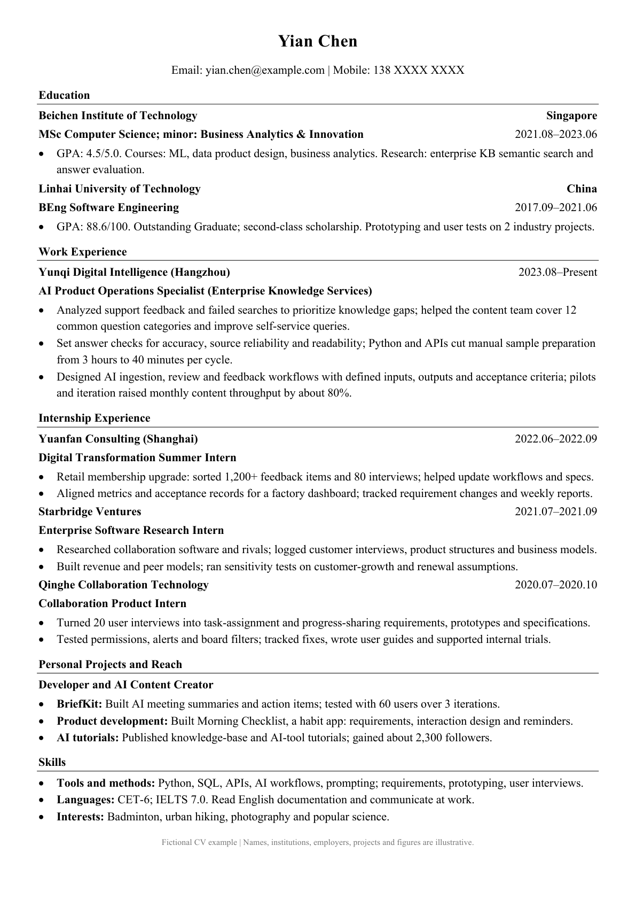
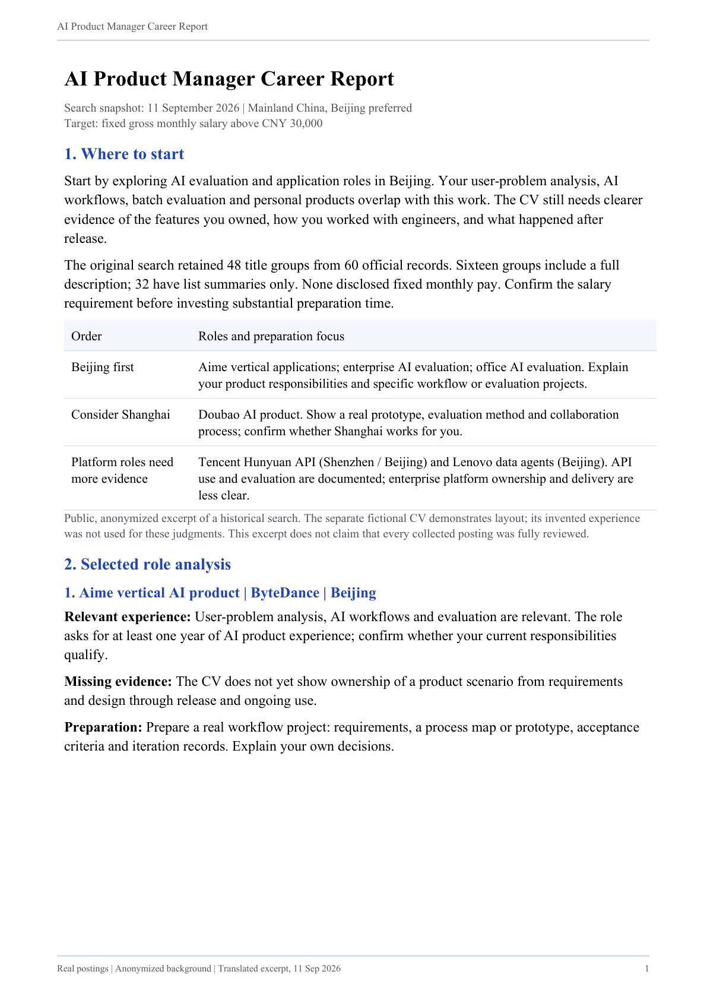

# job-hunt：求人探し、応募書類の作成、面接練習

<p align="center">
  <a href="README.md">English</a> ·
  <a href="README_ZH.md">简体中文</a> ·
  <a href="README_JA.md"><strong>日本語</strong></a> ·
  <a href="README_KO.md">한국어</a> ·
  <a href="README_ES.md">Español</a>
</p>

<p align="center">
  <a href="LICENSE"></a>
  
  <a href="https://github.com/addsumtech/job-hunt/releases"></a>
  <a href="https://skillhub.cn/skills/user_f486c577/best-job-hunt"></a>
  <a href="https://clawhub.ai/dong845/skills/job-hunt"></a>
</p>

<p align="center">
  <a href="CHANGELOG.md">変更履歴（中国語）</a>
</p>

**Claude Code と Codex 向けの求職 Skill：募集要項を全文読み、あなたの実際の経験だけで CV を直し、三つの独立した AI レビューで確認します。**

- **実際にやったことだけ**：新しい記述はすべて元の CV かあなたの回答までたどれます。元のプロフィールは変更しません。求人が求めていて足りないものは、不足点として示します。
- **募集要項を全文確認**：最終的に勧める求人は全文と照合し、読めなかったものは未確認として扱います。
- **三つの独立したレビュー**：ATS（読み取りとキーワード）、採用担当者（分かりやすさと基本条件）、採用責任者（経験が職務を裏付けるか）が別々に評価し、三つすべてが通過して初めて合格です（最大三回）。
- **ページごとのレイアウト確認**：Word/PDF は納品前にページごとに確認し、変更後は確認し直します。
- **確かめようのない数字は出さない**：「適合度 82%」のようなスコアは出さず、根拠、不足点、準備の負担だけを示します。

<p align="center">
  <a href="docs/assets/examples/cv-en.png"></a>
  <a href="docs/assets/examples/report-en-01.png"></a>
  <br><sub>左：CV の例（人物は架空）。右：2026 年 9 月の実際の求人調査レポートを匿名化した抜粋（当時は一部の候補が概要のみ）。<a href="docs/assets/examples/cv-zh.png">中国語 CV</a>、<a href="docs/assets/examples/report-en-02.png">レポート 2 ページ目</a>もあります。</sub>
</p>

### 評価での例

- **スキル欄の漏れを職歴から拾う**：ATS は「Slurm」で絞り込みますが、スキル欄にはなく、職歴の一項目に Slurm クラスターへの移行がありました。CV はその経験を使い、出典を記録しました。
- **本当に足りないものは取り繕わない**：オランダの臨床物理士登録（BIG）が必須でしたが、候補者は持っていませんでした。キーワードを入れず、必須条件として明示しました。
- **模擬面接で点数を付けない**：Skill なしで面接官を務めた同じモデルは「Verdict: would not advance. 8/25.」と返しました。job-hunt は点数も採否の結論も出しません。

<sub>2026 年 9 月の行動評価より。候補者は架空、各シナリオ 1 回の実行（n = 1）で、できたことを示すだけで頻度を示すものではありません。[評価記録](evals/iterations/iteration-2-with-skill.md)を参照。</sub>

希望条件、これまでの経験、求人リンクを渡すと、Agent が情報を整理し、要件を確認して書類の編集とレイアウトの点検を進めます。新卒、キャリアチェンジ、離職期間がある場合、技術職・研究職、海外への応募にも対応したガイドがあります。

## できること

| 機能 | 使う場面 | Agent が行うこと |
|---|---|---|
| **discover · 求人探し** | 希望分野はあるが、応募先が決まっていない | 地域と希望条件で探し、最終候補の募集要項を全文確認して、リンクと助言を整理 |
| **assess · 応募を検討する** | 特定の求人が自分に合うか判断したい | 要件と経験を比較し、応募資格、強み、不足点、準備の負担を説明 |
| **apply · CV と応募書類の作成** | CV を作りたい、または求人に合わせて直したい | 経験から初稿を作成、または既存の CV を編集し、Word/PDF の書式調整と独立レビューを実施 |
| **interview · 模擬面接** | 回答や追加質問への対応を練習したい | 求人と CV に基づいて面接を行い、回答を記録し、伝え方と事実の裏付けを確認 |

各機能は単独でも、必要に応じて組み合わせても使えます。次のステップはあなたが選び、完成した応募書類は自分で提出します。

任意機能：GitHub、Google Scholar、個人サイトを一度だけ尋ね、あなたが確認した新しいプロジェクトや論文をプロフィールに加えます。週に一度、新しい求人を自分宛てにメールで受け取ることもできます（メールツールと設定が必要です。使うかどうかはあなたが決めます）。

## 初めて使うとき

### 1. インストールと設定

下の[インストール](#インストール)から方法を一つ選びます。完了したら、Claude Code または Codex で次のように伝えてください。

```text
job-hunt を設定して、普段使っているブラウザーで作業を始めてください。
```

Agent が依存ツールを確認・準備し、必要なブラウザーの接続許可やサイトへのログインを案内します。別の Skill やブラウザー拡張機能は不要です。

### 2. 手元にある資料を渡す

求人探しには希望職種・地域・条件、評価には求人情報と経験を渡します。CV 作成には既存の書類、または学歴・職歴・プロジェクト経験を用意してください。模擬面接には求人情報と CV を使います。不足する情報は Agent が尋ねるので、先に決まった書式へ整理する必要はありません。

### 3. 今回やりたいことを伝える

以下は、それぞれ単独で使える依頼の例です。

```text
job-hunt を使って、上海の AI プロダクトマネージャー求人を探してください。
job-hunt を使って、この求人と私の CV から、応募する価値があるか評価してください。
job-hunt を使って、この経験から中国語と英語の CV を作り、Word と PDF で出力してください。
job-hunt を使って、この求人と私の CV に基づく模擬面接をしてください。
```

## 受け取れる成果物

| 成果物 | 内容 |
|---|---|
| **求職相談レポート（PDF）** | 今回の相談に応じた求人リンク、適合性の分析、強みと不足点、応募の優先順位や次の行動 |
| **求人に合わせた CV（Word/PDF）** | 経験から作成、または求人に合わせて編集した、修正可能な Word と組版済み PDF |
| **追加の応募書類（必要に応じて）** | カバーレター、志望動機書、雇用主指定のフォーム、条件別の応募説明 |
| **面接準備と振り返り（必要に応じて）** | 面接準備メモ、模擬面接の記録、回答の質と事実の裏付けに関する独立評価 |

相談ごとにレポートを作成し、その他の書類は選んだ作業に応じて用意します。地域や雇用主の指定に合わせ、日本の履歴書・職務経歴書、英国 NHS や公務員応募の supporting statement（条件別の説明文）など、適切な形式を使います。

成果物は `~/Downloads/<workspace-name>/` の一つのフォルダーにまとめ、`简历/`（CV）と `报告/`（レポート）に分けます。次の段階でも同じ場所を使うので、最新の書類を見つけやすくなります。

## インストール

ローカルコマンドの実行とファイルの読み書きができるエージェント環境、および **Python 3.10+** が必要です。`npx` を使う場合は Node.js/npm も必要です。次の四つから一つを選んでください。

### 方法 1：`npx skills` でインストール

```bash
npx skills add addsumtech/job-hunt
```

表示される案内に従ってエージェントとインストール範囲を選びます。ユーザー全体へのインストールには `-g`、エージェントの指定には `-a claude-code` または `-a codex`、確認の省略には `-y` を使えます。リポジトリのルートが Skill 本体なので、スクリプトと参照ファイルも一緒にインストールします。

### 方法 2：Claude Code プラグインとしてインストール

Claude Code 内で実行します。

```text
/plugin marketplace add addsumtech/job-hunt
/plugin install job-hunt@job-hunt
/reload-plugins
```

呼び出しは `/job-hunt:job-hunt` です。マーケットプレイスを更新する場合は `/plugin marketplace update job-hunt` を実行します。手動コピーとプラグインを併用すると、同じ Skill が二つ表示される場合があります。

### 方法 3：クローンしてシンボリックリンクを作成

ソースを読んだり編集したりする場合に適しています。以下は Claude Code への登録例です。

```bash
git clone https://github.com/addsumtech/job-hunt.git
cd job-hunt
mkdir -p ~/.claude/skills
ln -s "$PWD" ~/.claude/skills/job-hunt
```

Codex では最後の二行の `~/.claude/skills` を `~/.codex/skills` に置き換えます。リンク先が既に存在する場合は、既存のインストールを確認してください。

### 方法 4：SkillHub または ClawHub からインストール

[SkillHub](https://skillhub.cn/skills/user_f486c577/best-job-hunt) または [ClawHub](https://clawhub.ai/dong845/skills/job-hunt) で job-hunt の掲載ページを開き、各プラットフォームの案内に従ってインストールしてください。

## 対応地域と言語

51job、Indeed、LinkedIn、BOSS 直聘などから、対象地域とアクセス条件に合う情報源を選びます。中国市場では大手・中小の民間企業、国有企業、外資系企業などの希望も反映します。牛客は面接体験や選考プロセスの参考に使います。[情報源一覧](references/discovery-sources.md)と[利用ルール](references/source-policy.md)を参照してください。

CV の見出しと個人情報の項目名は、英語、オランダ語、ドイツ語、フランス語、スペイン語、イタリア語、中国語、日本語、韓国語に対応しています。求人探しと評価のレポートには、中国語、英語、日本語、韓国語、スペイン語の[言語別テンプレート](references/report-localization.md)があります。企業・業界調査では公式サイト、ニュース、WeChat 公式アカウント、関連 GitHub プロジェクトなどの[補足情報源](references/supplementary-sources.md)も使えます。

米国、英国、ドイツ、オランダ、中国の市場慣行表を 5 つ収録し、計 38 件の記録に出典、適用範囲、見直し日を付けています。写真、個人情報、応募書式は対象地域と雇用主の指定に合わせ、古い情報や不足する情報は確認を促します。

米国、カナダ、英国、アイルランド、オーストラリア、ニュージーランド向けの通常の CV では、写真と関連する個人情報を標準で省略します。他の認識済み地域では規則に沿って提供済みの情報を使い、地域が未確認なら省略します。

## 設定とよくある質問

### 検索や組版のツールは自分で入れる必要がありますか？

Skill のインストール後、Agent が共通のセットアップから Python パッケージ、Node.js、CDP パッチ付き OpenCLI を準備します。AnySearch クライアントとブラウザーリーダーは同梱され、AnySearch は API キー不要の HTTP API で検索します。CV の組版ツールは必要に応じて準備します。レポートは通常同梱フォントを使いますが、指定フォントを優先し、無断で置き換えません。[環境設定](references/agent-setup.md)を参照してください。

### ブラウザーの接続許可が必要なのはなぜですか？

Agent は標準で CDP（リモートデバッグ接続）を通じて普段の Chrome または Edge に接続し、ログイン状態を使います。初回は `chrome://inspect/#remote-debugging` でリモートデバッグを有効にして接続を許可する必要がある場合があります。Agent が対応状況を確認して案内します。作業中は接続を再利用し、独立した情報源は可能な範囲で同時に検索します。別のブラウザーは明示的に希望した場合だけ使います。[ブラウザー接続](references/daily-browser.md)に詳細があります。

### ログインや認証が必要、または求人を読めない場合は？

Agent はその情報源を一時停止し、ログインや認証を案内します。操作後に「完了したので続けて」と返信してください。引き続き取得できない場合は求人本文を渡すか、未確認の候補として残せます。

まず OpenCLI を検証し、非互換を確認した場合だけ同梱 CDP リーダーを使います。Indeed アダプターは現在米国サイトに接続するため、他国では現地の情報源を優先します。Indeed・51job の既知のパッチは OpenCLI 1.8.7 向けで、確認や復元を依頼できます。サイトの検索欄から直接探すこともできます。[互換性問題の対処](references/opencli-compat.md)を参照してください。

### 元のプロフィールや作業記録はどこに保存されますか？

この Skill は標準で `~/.claude/job-profiles/` を共有の保存先に使います。Claude Code や Codex に最初から付属するフォルダーではなく、プロフィール保存時に必要に応じて作成します。両方の Agent から同じ資料を再利用でき、`JOBHUNT_PROFILES_ROOT` で別の場所も指定できます。元のプロフィールは言語別に、応募用の作業領域は求人別に保存し、納品レポートや CV と分けます。Markdown、該当する場合の `.tex` ソース、確認記録は後の編集や追跡に使います。構成は [REFERENCE.md](REFERENCE.md)を参照してください。

ファイルはローカルに保存されます。モデルへのリクエストとウェブアクセスは、利用する Agent とサービス設定に依存します。

## 検証と関連資料

<details>
<summary>開発者向けのチェック、評価記録、技術文書を見る</summary>

自動チェックは、根拠への参照、元プロフィールの保護、レビュー結果の解析、個人情報の扱い、組版、モード間の引き継ぎなどを対象にしています。

```bash
PY=$(for p in python3.14 python3.13 python3.12 python3.11 python3.10 python3; do
  command -v "$p" >/dev/null && "$p" -c 'import sys; sys.exit(sys.version_info < (3, 10))' 2>/dev/null && { echo "$p"; break; }
done)
"${PY:?no Python 3.10+ found; install one first}" -m venv .venv && . .venv/bin/activate
pip install -r requirements.txt pytest
make check
make eval-lint
```

`make check` は Python テスト、移行時の内容保持チェック、市場慣行表のチェック、不可視文字の検査を実行します。Python 3.10 以上と `requirements.txt` の依存関係が必要です（macOS 標準の `python3` は 3.9 です）。外部ツールを使うテストには対応する環境が必要です。ローカルの Skill インストール検査は必要に応じて有効にできます。

[`evals/`](evals/README.md) には 20 の動作評価シナリオがあります。第 2 回評価（2026-09-05/06）では、15 のシナリオを Skill あり・なしで各一回実行しました（n = 1）。10 項目の動作チェックが、ベースラインの `FAIL` から Skill 使用時の `PASS` に変わりました。結果、未実施の項目、無効になったシナリオは[評価記録](evals/iterations/iteration-2-with-skill.md)に掲載しています。

三つの CV レビュー役は、2026-09-06 に `codex exec` で検証しました。他の Agent の設定方法とテスト範囲は[他の Agent での利用](references/portability.md)を参照してください。

- [SKILL.md](SKILL.md)：モードの振り分けと基本ルール。
- [REFERENCE.md](REFERENCE.md)：構成、作業領域、データ構造、スクリプトの使い方。
- [プロフィール例](assets/profile.example.yaml)と[記述の出典例](assets/claims.example.yaml)：構造化データの形式。
- [動作評価ガイド](evals/README.md)：評価方法と制約。

技術資料は現在、主に英語で記述されています。[MIT License](LICENSE) で公開しています。

</details>
